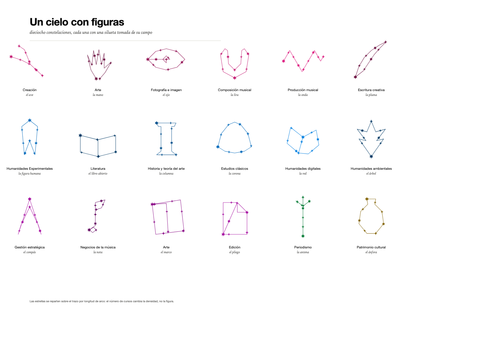

# La constelación: modelo visual e interacción

La Escuela no se explica con un organigrama ni con una cuadrícula de créditos. Se explica con un
**cielo**: las estrellas son cursos, las constelaciones son programas, y las estrellas compartidas
son la prueba visual de que la reforma articula en vez de duplicar.

Este documento fija la metáfora, las figuras, el algoritmo y la interacción.

---

## 1. La metáfora, término por término

| Cielo | Currículo | Regla visual |
|---|---|---|
| Cielo | Escuela | Todos los cursos, sin aristas, con retícula de carta estelar. |
| Estrella | Curso | Glifo según eje curricular; tamaño según cuántos programas lo comparten. |
| Constelación | Programa (maestría, énfasis, especializado) | Una **figura** propia y un trazo que la recorre. |
| Figura | Silueta del campo | Ver §2. Se dibuja completa; las estrellas se reparten sobre el trazo. |
| Núcleo | Cursos comunes a todos los énfasis de una maestría | Estrellas de tinta: no pertenecen a una constelación, las sostienen todas. |
| Puente | Curso compartido por dos constelaciones | Línea discontinua entre las dos copias de la estrella. |
| Magnitud | Grado de compartición | `4.5 + 1.4·√n_programas` px de radio. |
| Frontera | Agrupación por maestría | Arco tenue que separa sectores cuando hay varias maestrías activas. |

**La regla que evita el ovillo:** no se conectan todos con todos. Cada plan dibuja **un trazo** que
pasa por sus cursos. Un nodo tiene tantas aristas como planes lo incluyen (de 1 a 15), y esa
diferencia es información, no ruido.

---

## 2. Cada constelación tiene una figura

La figura no es decoración: es el nombre que la Escuela le pone a su currículo. Humanidades se lee
como una figura humana; Creación, como un ave; Patrimonio, como un ánfora.

| Programa | Figura | Por qué |
|---|---|---|
| Maestría en Creación | el ave | lo creativo como animal abstracto, en vuelo |
| Énfasis en Arte | la mano | el hacer, la materia |
| Énfasis en Fotografía, Imagen y Medios | el ojo | la mirada y el dispositivo |
| Énfasis en Composición Musical | la lira | el instrumento clásico |
| Énfasis en Producción Musical | la onda | la señal, el estudio |
| Énfasis en Escritura Creativa | la pluma | la escritura como objeto |
| Maestría en Humanidades Experimentales | la figura humana | las humanidades se representan a sí mismas |
| Énfasis en Literatura | el libro abierto | el texto |
| Énfasis en Historia y Teoría del Arte | la columna | el canon y su arquitectura |
| Énfasis en Estudios Clásicos | la corona | la tradición grecolatina |
| Énfasis en Humanidades Digitales | la red | el grafo, los datos |
| Énfasis en Humanidades Ambientales | el árbol | lo vivo y el territorio |
| Maestría en Gestión Estratégica | el compás | medir, proyectar, decidir |
| Énfasis en Negocios de la Música | la nota | el negocio del sonido |
| Énfasis en Arte (Gestión) | el marco | el ecosistema del arte |
| Énfasis en Edición | el pliego | la hoja impresa |
| Maestría en Periodismo | la antena | la señal pública |
| Maestría en Patrimonio Cultural | el ánfora | el bien que se conserva |



*Las dieciocho siluetas. La figura se dibuja completa y las estrellas se reparten sobre su trazo por
longitud de arco: el número de cursos cambia la densidad, nunca la silueta.*

### Cómo se dibuja una figura

Cada figura es una polilínea normalizada en una caja de `0..100`. Se dibuja entera y las estrellas
—una por curso— se colocan sobre ella por longitud de arco:

```
P(t) = punto a distancia t·L sobre la polilínea,   t = i/(n-1),  L = longitud total
```

Una figura con siete cursos y otra con once comparten silueta y cambian de densidad. La figura vive
en `FIGURAS` (`src/lib/domain/figures.ts`), indexada por `programa_id`. Su posición en el cielo es
fija: se calcula una vez (§4) y no depende de la selección.

---

## 3. Escalas de entrada

La reforma permite entrar por abajo y acumular. La escalera es:

| Escala | Qué es | Cómo se ve |
|---|---|---|
| **Curso umbral** | **Un curso del cuerpo de un programa especializado.** No es un curso aparte: es la unidad mínima homologable. | Una sola estrella de la figura del especializado, encendida sobre el cielo. |
| **Programa especializado** | Los 4 cursos del cuerpo de especialización (12 cr). | La figura con 4 estrellas y línea larga discontinua. |
| **Énfasis** | El plan completo del énfasis (36 cr). | La figura completa, con su núcleo. |
| **Maestría** | Núcleo común + las figuras de todos sus énfasis. | Una familia de figuras (§4.3). |

El curso umbral no tiene programa propio: se modela como **una estrella del especializado** y la
interfaz lo ofrece con la acción «ver como umbral» sobre cualquier curso de un cuerpo de
especialización. Así la escala menor no inventa datos ni duplica cursos.

---

## 4. El cielo se pliega

Dos estados, no dos modos: **nebulosa** (nada seleccionado) y **constelación** (uno o dos programas).
Al elegir, las estrellas del programa **viajan** a su figura. Al deseleccionar, vuelven a su sitio.

La consecuencia que asumimos: las posiciones **sí** dependen de la selección. Se gana legibilidad —la
figura se lee al 100 %, sin zoom— y se pierde el mapa estable. Para un comité que ve la pieza cinco
minutos, el intercambio es correcto: importa el momento en que la figura aparece, no memorizar el
cielo.

```
nebulosa        → posición de reposo de los 83 cursos   (fija, sembrada, en JSON)
figura(p)       → posición canónica de los cursos de p  (puro)
componer(A, B?) → posiciones finales + núcleo           (puro)
```

### 4.1 La nebulosa

Sin selección, los 83 cursos forman un cielo **al azar**, no un diagrama:

- Posiciones sembradas, con una separación mínima de 17 px que solo evita que dos estrellas se
  pisen. Hay huecos y parejas cercanas, como en un cielo de verdad.
- **La posición no codifica nada.** Nada de cúmulos por maestría: agrupar por facultad convertía el
  cielo en un diagrama de clusters, justo lo que la metáfora quiere evitar.
- El color sigue distinguiendo la maestría, y una leyenda al pie lo explica. El color informa; la
  posición descansa.
- Se calcula una vez en build (`atlas.json`) con semilla fija. En pantalla nadie simula: se lee.

**Las siluetas también son selector.** Repartidas por el cielo —al azar sembrado, sin pisarse— se
dibujan las quince figuras: los trece énfasis y las dos maestrías sin énfasis. Sin estrellas: solo el
trazo. Un clic en una silueta abre ese programa. Es el segundo camino de entrada, además de la lista
de la izquierda, y el que hace que el cielo se pueda leer sin menús.

Nada de anillos ni de rejillas: un cielo no ordena sus figuras en círculo. Se siembran y se separan
hasta que ninguna toca a otra.

### 4.2 Una constelación

El programa seleccionado se dibuja **desde el núcleo**, que es su base:

```
        ▲ figura del énfasis (7 cursos propios, en su silueta)
        │
   ─────┴─────  núcleo (4 cursos comunes a todos los planes de la maestría)
```

- La figura crece hacia arriba desde el núcleo; el núcleo se queda abajo, centrado.
- Los cursos del programa viajan a su posición; **el resto de la nebulosa no se mueve**, baja a
  opacidad 28 % y deja un hueco donde estaban.
- El hueco importa: muestra de dónde salió la constelación.

### 4.3 Una maestría no es una figura: es una familia

Una maestría con cinco énfasis tiene treinta y un cursos propios. Meterlos en una sola silueta los
amontona: a 31 estrellas sobre un trazo de doce vértices no se lee nada. Por eso:

- **Énfasis, especializado o maestría sin énfasis** → una figura sola, grande, sobre el tronco.
- **Maestría con énfasis** → la familia de sus figuras: cada énfasis conserva la suya con sus cursos
  exclusivos, en dos filas sobre el tronco. Lo que comparten algunos énfasis (los cuatro seminarios de
  Composición y Producción musical) se agrupa en columna entre sus figuras.

La maestría no tiene silueta propia. Tiene nombre, color y las siluetas de sus hijos.

**Y se puede cursar sin énfasis.** La maestría «a secas» es válida: su plan es la rejilla del plan
marco —doce casillas, de las cuales siete están abiertas— y el panel derecho la muestra completa,
con los énfasis como rutas opcionales debajo. Elegir un énfasis no es condición para graduarse; es
una forma de llenar esas casillas.

### 4.5 Comparación: aplazada

Comparar dos programas exigía que dos figuras compartieran estrellas. Se probó con alineación rígida
(Procrustes) y con reparto por periodo; cuando dos programas comparten cuatro de siete cursos, no hay
transformación que conserve las dos siluetas: alguna se deforma o las estrellas se despegan del trazo.
Queda fuera hasta tener una solución que no obligue a elegir entre forma y dato.

### 4.6 El viaje

- 600 ms, `cubic-bezier(.2,0,.2,1)`.
- Las estrellas compartidas se mueven **al final**: son la bisagra y deben llegar juntas.
- Los nodos se escalonan por distancia recorrida (20 ms entre uno y otro) para que el ojo siga el
  movimiento en vez de ver un salto.
- Al deseleccionar, el viaje se invierte y la nebulosa recupera sus estrellas.
- Con `prefers-reduced-motion`, el estado final aparece sin animación.

### 4.7 Estados de una estrella

| Estado | Glifo | Opacidad | Posición |
|---|---|---|---|
| En la nebulosa | Punto sólido | 28 % | Su lugar en la nube |
| En la selección | Glifo del eje, color del programa | 100 % | En su figura |
| Compartida entre A y B | Glifo + doble anillo | 100 % | Punto medio, bisagra |
| En el tronco | Glifo de tinta | 100 % | Base, compartida por A y B |
| Fuera de selección | Punto sólido | 28 % | No se mueve |

---

## 5. Estabilidad

Dentro de una misma selección, el resultado es determinista: los mismos dos programas producen
exactamente la misma composición, siempre. La nebulosa es fija y vive en `atlas.json`.

Lo que cambia entre selecciones es el encuadre de las figuras, no el de la nube: el resto del cielo no
se mueve nunca. Esa mitad estable es la que da orientación.

---

## 6. Semántica de líneas y nodos

### Líneas

| Estilo | Significado |
|---|---|
| Sólida 1.5 px, color del programa | Curso del plan seleccionado. |
| Trazo de figura, mismo color al 55 % | La silueta: existe aunque el curso no esté en el plan. |
| Discontinua corta (7 4) | Alternativa: «teoría 1, 2 o 3». |
| Discontinua larga (16 3 2 3) | Programa especializado. |
| Punteada fina (2 4) | Conexión de una estrella compartida con una figura no seleccionada. |
| Gris al 28 % | Pertenencia de una constelación no activa. |

### Nodos

| Atributo | Codifica |
|---|---|
| Glifo | `eje_curricular` |
| Tamaño | `n_programas` (6–10.5 px) |
| Relleno | Tinta si `alcance = escuela`; color del programa si es propio |
| Doble anillo | Curso compartido con otra constelación activa |
| Borde discontinuo | `estado = propuesto` |
| Rótulo | Código siempre; nombre completo al pasar el cursor o al enfocar |

Los rótulos se colocan radialmente hacia afuera del centro de la figura. Si dos chocan, gana el de
mayor `n_programas` y el otro se oculta hasta el hover.

---

## 7. Estados de vista

| Estado | Qué se ve | Para qué |
|---|---|---|
| **Nebulosa** | 83 estrellas sin aristas, agrupadas por afinidad | «Esto es todo lo que ofrece la Escuela» |
| **Una constelación** | Una figura creciendo del tronco; el resto atenuado | Leer un programa |
| **Dos constelaciones** | Dos figuras sobre el mismo tronco, compartidas en el medio | Comparar |
| **Tabla** | El mismo conjunto en tabla accesible y exportable | Actas de comité, impresión |

---

## 8. Interacción

| Acción | Efecto | Estado |
|---|---|---|
| Elegir un programa | Sus estrellas viajan a la figura; el resto baja a 28 % | `selectedPrograms` |
| Elegir otro programa | El anterior vuelve a la nube y el nuevo se arma | `selectedPrograms` |
| Arrastrar | Paneo del cielo (sin zoom: la figura ya está a escala) | `camera` |
| Clic en una figura | La selecciona y abre la lista de cursos | `selectedPrograms`, `panel` |
| Clic en una estrella | Detalle del curso y resalte de sus otras constelaciones | `selectedCourse` |
| Hover en estrella | Atenúa el resto; muestra los programas que la contienen | `hoveredCourse` |
| Hover en estrella compartida | Nombra el curso y las constelaciones que lo usan | `hoveredCourse` |
| Esc | Cierra el detalle; segundo Esc deselecciona todo | `panel`, `selectedPrograms` |
| `Tab` / `←→` | Recorre constelaciones y estrellas | `focusIndex` |
| «Mostrar alternativas» | Muestra u oculta aristas discontinuas | `showAlternatives` |

Un programa a la vez. Elegir otro apaga el anterior sin preguntar.

### Panel lateral

**Plan de estudios.** El panel derecho muestra las doce casillas en orden cronológico, agrupadas por
periodo, con el nombre completo del curso, su código, sus créditos y su glifo. En una maestría lista
sus énfasis —cada uno se abre con un clic—. Pasar el cursor por una casilla enciende su estrella y
viceversa: los dos lados se buscan.

**Modo curso:** nombre, código, créditos, eje, formato, oferta variable; programas que lo contienen
agrupados por escala; «aparece en N de los 15 planes»; acción «ver como umbral» si pertenece a un
cuerpo de especialización.

---

## 9. Casos borde

| Caso | Comportamiento |
|---|---|
| Curso que solo existe como alternativa | Se dibuja con línea discontinua corta y no suma créditos. |
| Curso compartido por dos énfasis de la maestría | Una sola estrella en columna, entre sus figuras. |
| Constelación sin cursos | Figura dibujada en punteado, sin estrellas, con texto explicativo. |
| Datos propuestos | Borde discontinuo y etiqueta «propuesta» en el panel. |
| Ventana < 720 px | Una columna; las dos figuras se apilan sobre el tronco; panel como hoja inferior. |

---

## 10. Accesibilidad

- Cada estrella es un `<g role="button" tabindex="0">` con `aria-label` = nombre, créditos y programas.
- El orden de tabulación sigue los sectores, no el DOM visual.
- La vista Tabla es un componente de primera clase.
- Contraste: líneas ≥ 3:1, texto siempre en tinta ≥ 4.5:1.
- `prefers-reduced-motion` elimina trazos animados y pulsos.
- Ningún significado depende solo del color: hay patrón de línea, número de leyenda y doble anillo.

---

## 11. Lo que esta visualización no es

- No es un editor de mallas curriculares: el currículo se edita en `scripts/build-data.mjs`.
- No es un grafo de prerrequisitos: las líneas son pertenencia, no causalidad.
- No habrá 3D, partículas animadas ni modo oscuro.
- No se muestran las cinco maestrías completas a la vez: para eso está el modo Cielo.

---

## 12. Preguntas abiertas para el comité

1. **Núcleo.** ¿Los transversales y la electiva deben contar como núcleo? Hoy sí, y eso hace el
   centro de cada maestría muy brillante.
2. **Figuras.** Las dieciocho siluetas son una primera versión; ¿alguna no representa el campo?
   Cambiarlas es editar una polilínea, no el modelo.
3. **Comparación.** ¿Interesa comparar dos maestrías completas o solo énfasis homólogos
   («Arte» en Creación frente a «Arte» en Gestión)?
