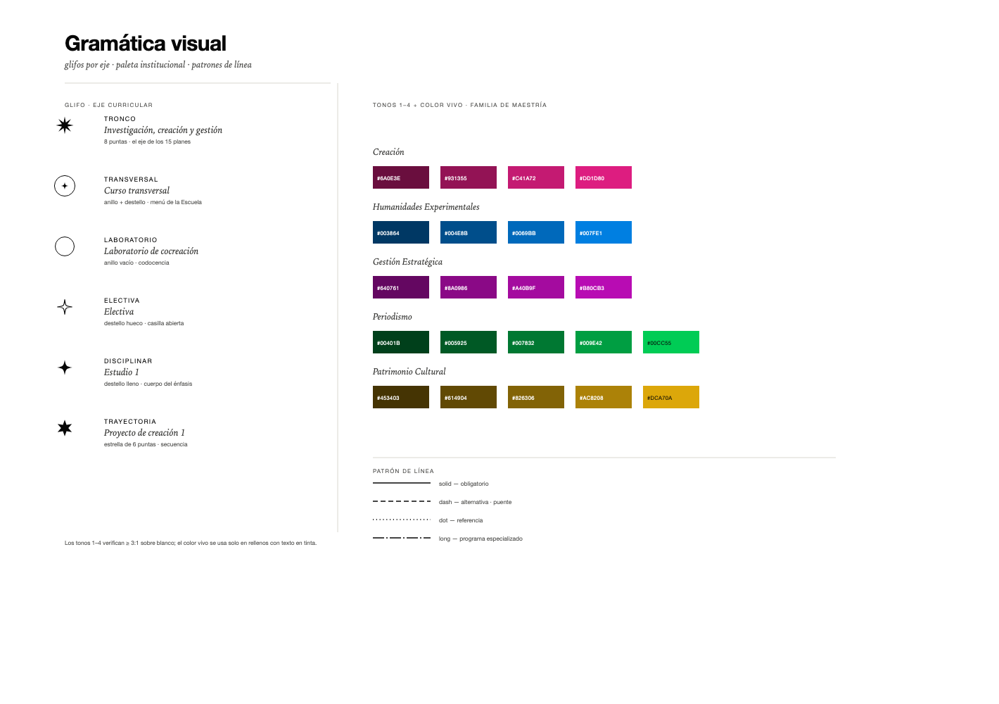

# Sistema de diseño

La identidad viene de la Facultad, no del proyecto: la tipografía y los colores se tomaron de
`artehum.uniandes.edu.co` (tema *Arthum*). Sobre esa base se construye una gramática de carta
estelar: **blanco, línea fina, color solo donde significa algo.**

---

## 1. Principios

1. **El vacío es información.** Un cielo con pocas estrellas dice algo; no se rellena con decoración.
2. **Un color, una familia.** El color identifica una maestría; los énfasis son tonos de esa familia.
3. **La forma es el dato.** Nada se mueve, brilla o se colorea si no codifica algo.
4. **La línea es un argumento.** Cada trazo debe poder explicarse en una frase.
5. **Tres tipografías, ninguna más.** Mikrobe para el nombre, Palast para la voz editorial, Area para el dato.

---

## 2. Tipografía

La Facultad carga un kit de Adobe Fonts con tres variables. La app **usa el mismo kit**; el respaldo
es para desarrollo sin conexión y para las láminas de `docs/assets/`.

| Token | Fuente | Uso | Respaldo |
|---|---|---|---|
| `--ff-display` | `mikrobe-variable` | Títulos de pantalla, cifras grandes | `"Helvetica Neue", "Archivo", Arial, sans-serif` |
| `--ff-serif` | `palast-variable` | Nombres propios: maestrías, cursos, citas | `"Iowan Old Style", Baskerville, Georgia, serif` |
| `--ff-sans` | `area-variable` (Inktrap) | Interfaz, metadatos, códigos de estrella, tablas | `"Helvetica Neue", "Archivo", Arial, sans-serif` |

Ajustes de eje copiados del sitio: `font-variation-settings: 'INKT' 100` en Area;
`'opsz' 10` en Palast. Los botones usan Area con `'INKT' 100` y peso 700.

Escala semántica (px): `12 · 14 · 16 · 18 · 22 · 28 · 34 · 44`, de `--fz-xs` a `--fz-4xl`.
Subió un escalón completa respecto de la versión de escritorio: la pieza se lee en proyector y en la
sala del comité, no en una laptop a 40 cm.

Interlineado 1.35 en cuerpo, 1.05–1.1 en títulos. Tracking `0.14em` en versalitas, `-0.02em` en
títulos display. Ningún componente declara un tamaño en píxeles: siempre `--fz-*`.

Reglas: no cursiva en Area; no versalitas en Palast; números tabulares siempre.

---

## 3. Color

### 3.1 Base

Tomada del tema: negro `#070707`, blanco cálido `#EFEEE8`, gris `#5A5A58`.
El cielo usa blanco puro para que la retícula y las estrellas respiren; el papel cálido se reserva
para paneles y barra de herramientas.

| Token | Hex | Uso | Contraste s/ blanco |
|---|---|---|---|
| `--c-paper` | `#FFFFFF` | Fondo del cielo | — |
| `--c-papel` | `#EFEEE8` | Paneles, barra, hoja inferior | 1.16:1 (solo superficie) |
| `--c-ink` | `#070707` | Texto, núcleo, líneas base | 20.1:1 |
| `--c-ink-2` | `#3A3A38` | Rótulos de estrella, texto secundario | 11.4:1 |
| `--c-ink-3` | `#5A5A58` | Metadatos, notas | 6.9:1 |
| `--c-rule` | `#D9D7CF` | Filetes | decorativo |
| `--c-grid` | `#F1F0EA` | Retícula de cielo | decorativo |
| `--c-focus` | `#007FE1` | Anillo de foco (2 px, offset 2) | 4.1:1 |

### 3.2 Familias de maestría

Cinco colores institucionales (`007fe1 · 00cc55 · dd1d80 · dca70a · a40b9f`). Como los colores de
marca son demasiado claros para una línea de 1.5 px, cada familia se ramifica en **cuatro tonos
oscurecidos** que sí cumplen contraste, más el **color vivo** para rellenos.

| Familia | Tono 1 | Tono 2 (maestría) | Tono 3 | Tono 4 | Vivo |
|---|---|---|---|---|---|
| Creación · magenta | `#6A0E3E` | `#931355` | `#C41A72` | `#DD1D80` | `#DD1D80` |
| Humanidades Experimentales · azul | `#003864` | `#004E8B` | `#0069BB` | `#007FE1` | `#007FE1` |
| Gestión Estratégica · morado | `#640761` | `#8A0986` | `#A40B9F` | `#B80CB3` | `#A40B9F` |
| Periodismo · verde | `#00401B` | `#005925` | `#007832` | `#009E42` | `#00CC55` |
| Patrimonio Cultural · ocre | `#453403` | `#614904` | `#826306` | `#AC8208` | `#DCA70A` |

Contraste de los tonos sobre blanco: 12:1 · 8.5:1 · 5.6:1 · 3.5:1 (el tono 4 de morado, 5.6:1).
Todos sirven para líneas y halos; los rótulos van siempre en tinta.



*Lámina de control: glifos, rampas de color y patrones. Si un token no aparece aquí, no existe.*

**Asignación:** la maestría usa el tono 2; sus énfasis usan tonos 1–4 según su índice. El color vivo
solo aparece en rellenos con texto en tinta (chips, leyenda, halos) y en la franja superior de la ficha.

### 3.3 Marca de familia

El color vivo rebajado sobre blanco, como fondo de un título. Es la firma de una maestría dicha sin
gritar: sirve para reconocer de un vistazo a qué familia pertenece un bloque.

| Token | Hex | Dónde se usa |
|---|---|---|
| `--hl-creacion` | `#F2A9CF` | Nombre de la maestría en el selector; títulos de periodo en su plan |
| `--hl-he` | `#A8D3F6` | ídem |
| `--hl-gepc` | `#DFAADE` | ídem |
| `--hl-perio` | `#A5ECC3` | ídem |
| `--hl-patrim` | `#F2DD9D` | ídem |
| `--hl-ink` | `#E4E2DA` | Reserva: títulos sin familia (escuela, cielo) |

Reglas:

- **Es un fondo, nunca texto.** Sobre la marca siempre va tinta `#070707`.
- **Solo títulos y rótulos cortos**: nombre de maestría, título de periodo, rótulo de una figura al
  pasar el cursor. Nunca párrafos, nunca texto de cuerpo, nunca dos marcas en la misma línea.
- En SVG la marca es un `rect` con la clase `.hl-*` (que fija `fill` además de `background`), y el
  texto encima va en tinta.
- Se aplica con la clase `.marca` más `.hl-<familia>`; el aire es `0.08em 0.34em`. Nada de estilos
  inline.
- Nunca es el único portador de significado: el nombre del programa y la palabra «periodo» siguen
  ahí aunque no se distinga el color.

### 3.4 Estado del dato

| Estado | Tratamiento |
|---|---|
| `verificado` | Sin marca. |
| `derivado` | Sin marca (el dato se explica en la ficha). |
| `propuesto` | Borde discontinuo del glifo + etiqueta «propuesta» en la ficha. |
| `pendiente` | Constelación vacía con borde punteado y texto explicativo. |

---

## 4. Espaciado, trazos y movimiento

- Escala: `4 · 8 · 12 · 16 · 24 · 32 · 48 · 64 · 96`. Base 4.
- Radios: `0` por defecto; `999px` solo en chips y botones (como el sitio de la Facultad).
- Trazos: `--stroke-grid` 0.9 (retícula) · `--stroke-const` 2.4 (constelación) ·
  `--stroke-link` 1.2 (enlace tronco → figura) · `--stroke-active` 3 (foco).
  La línea de constelación pesa más que cualquier otra cosa en pantalla: es el dibujo.
- Sombras: ninguna. Gradientes: ninguno.
- Movimiento: `120ms` hover · `220ms` panel · `360ms` entrada de constelación ·
  `cubic-bezier(.2,0,0,1)`. Con `prefers-reduced-motion`, estados finales sin animación.

---

## 5. Glifos de estrella

Un glifo = un eje curricular. Se construyen en una retícula de radio 1 y se escalan al tamaño final.

| Glifo | Eje | Construcción |
|---|---|---|
| Rosa de 8 puntas | `tronco` | Polígono de 16 vértices, radio 1 / 0.34 |
| Anillo + destello | `transversal` | Círculo r=1.62 (trazo 1) + destello r=0.58 |
| Anillo vacío | `laboratorio` | Círculo r=1.5, trazo 1 |
| Destello hueco | `electiva` | Destello de 4 puntas r=1.18, solo trazo |
| Destello lleno | `disciplinar` | Destello de 4 puntas r=1.2, relleno |
| Estrella de 6 puntas | `trayectoria` | Polígono de 12 vértices, radio 1.3 / 0.57 |

Tamaño: `r = 9 + 2.8·√n_programas`, acotado a `[9, 20]` px. En la nebulosa se dibuja al 42 % de ese
radio: el cielo de fondo no compite con la constelación encendida.

---

## 6. Componentes

| Componente | Props | Estados | Regla |
|---|---|---|---|
| `ProgramPicker` | `programs`, `selectedIds` | vacío, activo | Plegable por maestría; la del programa elegido se abre sola. **Un programa a la vez.** |
| `ProgramChip` | `program`, `tono`, `vivo`, `selected`, `index` | normal, hover, activo | Fondo tono 1, texto papel; punto vivo de 6 px a la izquierda. |
| `SkyStage` | `graph`, `figures`, `mode` | cielo, constelación, vacío | Único componente que dibuja el SVG. Sin lógica de dominio. |
| `ConstellationPath` | `programId`, `color`, `pattern`, `points`, `figure` | normal, hover, atenuado | Una `path` por constelación; la figura se dibuja completa. |
| `SilhouetteSelector` | `siluetas`, `onElegir` | normal, hover, foco | Sin selección, las quince siluetas repartidas por el cielo, sin pisarse. Trazo al 22 %; al pasar el cursor, 85 % y el nombre. Zona de contacto: relleno transparente + círculo de 46 px. |
| `Star` | `course`, `x`, `y`, `r`, `state` | normal, hover, foco, atenuado | `role="button"`, `aria-label` completo y foco por teclado. Al pasar el cursor: halo y rótulo fijo, y la fila del plan se resalta. Fuera de selección: punto sólido al 22 %. |

| `PlanPanel` | `programaId`, `resaltado`, `onHover`, `onElegir` | plan, familia | Panel derecho: el plan en orden cronológico, con glifo, nombre completo, código y créditos. En una maestría, lista sus énfasis. |
| `Composer` | `figures`, `nucleus` | figura, familia | Compone la escena; puro, sin DOM. |
| `CourseList` | `courses`, `groupBy="eje"` | normal, vacío | Agrupa por eje, ordena por periodo. |
| `CourseDetail` | `course`, `programs` | normal | Escalas de pertenencia, de mayor a menor. |
| `StatusBadge` | `state` | propuesto, pendiente | Solo si el dato no es verificado. |
| `Sheet` | `open`, `side` | cerrado, abierto | Panel en escritorio, hoja inferior en móvil. |
| `EmptySky` | `reason` | — | Explica el vacío. Nunca pantalla en blanco. |

### Anatomía

```
┌──────────────────────────────────────────────────────────────┐
│ Toolbar · modo · alternativas · leyenda                      │
├──────────────┬───────────────────────────────┬───────────────┤
│ ProgramPicker│ SkyStage                      │ PlanPanel     │
│ 240 px       │ flex, mín. 480 px             │ 360 px        │
└──────────────┴───────────────────────────────┴───────────────┘
```

En `< 720 px`: chips en fila desplazable, cielo a ancho completo, panel como hoja inferior.

---

## 7. Tokens listos para `src/styles/tokens.css`

```css
:root {
  /* Tipografía — kit Adobe Fonts de la Facultad */
  --ff-display: "mikrobe-variable", "Helvetica Neue", "Archivo", Arial, sans-serif;
  --ff-serif:   "palast-variable", "Iowan Old Style", Baskerville, Georgia, serif;
  --ff-sans:    "area-variable", "Helvetica Neue", "Archivo", Arial, sans-serif;
  --fz-11: 0.55rem; --fz-125: 0.625rem; --fz-14: 0.7rem; --fz-16: 0.8rem;
  --fz-20: 1rem;   --fz-25: 1.25rem;   --fz-30: 1.5rem;  --fz-40: 2rem;

  /* Color base */
  --c-paper: #ffffff; --c-papel: #efeee8;
  --c-ink: #070707; --c-ink-2: #3a3a38; --c-ink-3: #5a5a58;
  --c-rule: #d9d7cf; --c-grid: #f1f0ea; --c-focus: #007fe1;

  /* Familias */
  --c-creacion-1: #6a0e3e; --c-creacion-2: #931355; --c-creacion-3: #c41a72; --c-creacion-4: #dd1d80; --c-creacion-vivo: #dd1d80;
  --c-he-1: #003864;       --c-he-2: #004e8b;       --c-he-3: #0069bb;       --c-he-4: #007fe1;       --c-he-vivo: #007fe1;
  --c-gepc-1: #640761;     --c-gepc-2: #8a0986;     --c-gepc-3: #a40b9f;     --c-gepc-4: #b80cb3;     --c-gepc-vivo: #a40b9f;
  --c-perio-1: #00401b;    --c-perio-2: #005925;    --c-perio-3: #007832;    --c-perio-4: #009e42;    --c-perio-vivo: #00cc55;
  --c-patrim-1: #453403;   --c-patrim-2: #614904;   --c-patrim-3: #826306;   --c-patrim-4: #ac8208;   --c-patrim-vivo: #dca70a;

  /* Espacio, trazo, movimiento */
  --sp-1: 4px;  --sp-2: 8px;  --sp-3: 12px; --sp-4: 16px;
  --sp-6: 24px; --sp-8: 32px; --sp-12: 48px; --sp-16: 64px;
  --stroke-grid: 0.8; --stroke-const: 1.5; --stroke-active: 2;
  --op-dim: 0.28; --op-mid: 0.6; --op-on: 1;
  --d-move: 600ms; /* viaje de las estrellas a su figura */
  --t-fast: 120ms; --t-base: 220ms; --t-slow: 360ms;
  --ease: cubic-bezier(.2, 0, 0, 1);
}
```

---

## 8. Reglas estrictas

1. **Prohibido el atributo `style`.** Los tokens viven en CSS; la geometría se pasa como atributos
   SVG (`cx`, `cy`, `d`, `transform`). *Excepción única*: `transform` calculado por la simulación.
2. **Prohibido duplicar estilos.** Tres reglas compartidas ⇒ clase utilitaria o componente base.
3. **Toda forma interactiva tiene zona de contacto.** El trazo nunca es el blanco: cada glifo lleva
   un disco transparente de `1.95·r` y cada silueta un relleno transparente más un círculo de 46 px en
   su centro. Un trazo de 1,6 px no se acierta con el ratón.
4. **Prohibido el color como único portador de significado.** Siempre color + patrón + número.
5. **Prohibidos los tooltips como única fuente.** Todo dato está también en el panel.
6. **Prohibido el texto en el color del programa.** El color es de la línea; el texto es tinta. La
   marca de familia es un fondo, no una tinta.
7. **Prohibidos sombras, gradientes, glassmorphism y emojis.**
8. **Prohibido animar `width`, `height`, `top`, `left`.** Solo `transform`, `opacity` y
   `stroke-dashoffset`.
9. **Prohibido el modo oscuro.** El blanco es una decisión.
10. **Un solo programa activo y 3 controles en la barra.** La comparación está aplazada hasta tener
   una solución que no obligue a deformar figuras.
11. **Ningún componente declara una familia tipográfica literal.** Se usa `--ff-*`.

---

## 9. Microcopy

Español, frase simple, sin exclamaciones. «Constelación», «estrella», «figura», «núcleo», «encuadre».
Se dice **curso**, no «materia»; **énfasis**, no «mención»; **programa especializado**, completo.
Los vacíos explican: «Los cursos umbral se toman de un programa especializado; aún no hay inscripción
abierta».
