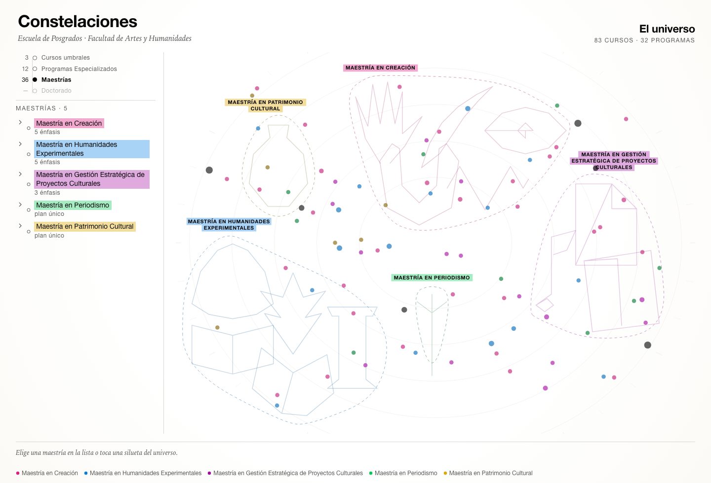
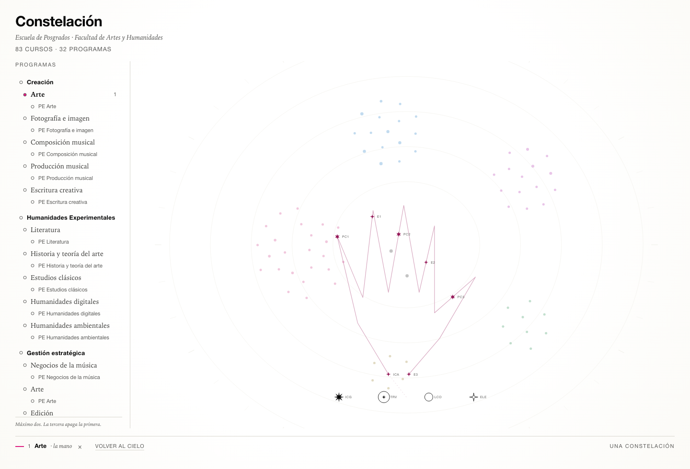
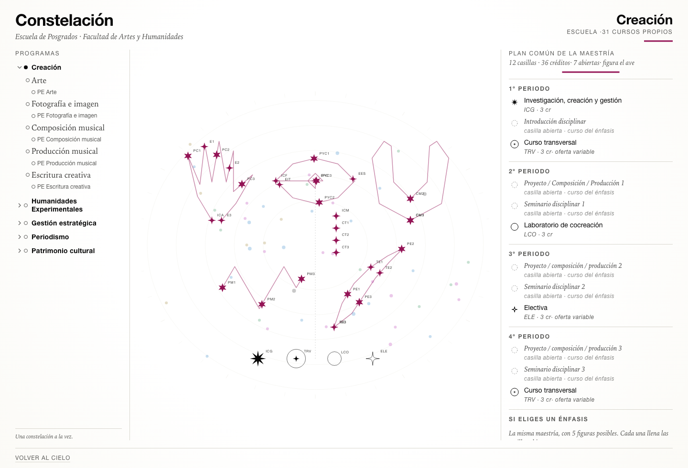

# Plan activo

**Fase actual: 1 completado — datos tipados, dominio y nebulosa.** La app ya dibuja el cielo
completo; todavía no hay selección. Lo que sigue está ordenado para que cada sprint produzca algo
mostrable al comité.

---

## Sprint 0 · Plan y datos ✅

- [x] Analizar el documento maestro (110 pp.) y localizar las 18 tablas de plan de estudios
- [x] Desagregar el currículo a cursos como unidad mínima → `data/cursos.csv` (83)
- [x] Registrar pertenencias curso ↔ programa → `data/curriculo.csv` (236)
- [x] Registrar la jerarquía de programas → `data/programas.csv` (32)
- [x] Derivar los 13 programas especializados (4 cursos / 12 cr cada uno)
- [x] Validar invariantes (36 cr por plan, 12 cr por especializado)
- [x] Documentar arquitectura, sistema de diseño, modelo visual y modelo de datos
- [x] Generar las láminas de validación (`docs/assets/`)
- [x] Derivar tipografías y paleta del sitio de la Facultad
- [x] Definir una figura por constelación (18 siluetas) y su regla de reparto
- [x] Dejar explícito lo que falta: doctorado y menú transversal

**Entregable:** `data/` + `docs/`. Nada de código de aplicación.

---

## Sprint 1 · Datos tipados y dominio ✅

Objetivo: que la app pueda construir el grafo sin tocar CSV y sin adivinar nada.

- [x] `scripts/build-curriculum.mjs`: CSV → `src/lib/data/curriculum.json` + validación de contrato
- [x] `types.ts`: `Curso`, `Programa`, `Oferta`, `CurriculumBundle`
- [x] `data/figures.json`: las 18 siluetas, fuente única para la app y las láminas
- [x] `domain/graph.ts`: cursos de un programa (una maestría es la unión de sus énfasis), núcleo,
      grafo de una selección
- [x] `domain/figures.ts`: `placeOnFigure(polilínea, n)` por longitud de arco
- [x] `domain/nebula.ts`: atlas → viewport
- [x] `domain/compose.ts`: escena para 0, 1 y 2 programas, con bisagra
- [x] `scripts/build-atlas.mjs`: nebulosa determinista (semilla 20261029, sin `Math.random`)
- [x] `styles/tokens.css` y `app.css`
- [x] `SkyStage.svelte`: 83 estrellas, retícula, rótulos de región
- [x] Pruebas: contrato (4), grafo (3), figuras (3), nebulosa (2), composición (3) = **15**

**Aceptación:** ✔ el cielo se renderiza con 83 estrellas en 1200×900; recargar no mueve ninguna;
`vitest` 15/15; `svelte-check` sin errores; build de 137 kB (27 kB gzip).

*Primer render: cinco regiones, el núcleo de la Escuela en tinta y ninguna figura todavía.*

**Notas de implementación.**

- No se instaló `d3`: el SVG lo resuelve Svelte. `d3-scale`/`d3-zoom` entrarán con la cámara y la
  transición en el sprint 2; `d3-force` no entra nunca (el atlas es determinista).
- El viewBox es fijo (1200×900) y la escena se compone en esas coordenadas: el cielo escala solo.
- Las alternativas cuentan para el ancla de la nebulosa (un curso alternativo sigue siendo de ese
  plan), pero no para el grafo de pertenencias obligatorias.

---

## Sprint 2 · El viaje ✅

Objetivo: elegir un programa y ver su constelación armarse sobre el cielo.

- [x] `viz/motion.ts`: plan de viaje con escalonado por distancia y bisagras al final
- [x] `SkyStage` anima con rAF: interpola posiciones, no redibuja el cielo
- [x] `ProgramPicker` con la jerarquía maestría → énfasis → especializado y tope de dos
- [x] `Legend` con color, nombre y figura («la mano»), y quitar
- [x] Esc y «Volver al cielo» deseleccionan
- [x] Estado en el hash: un enlace comparte la constelación (`#enf-creacion-arte`)
- [x] Segunda selección: las figuras se inclinan alrededor de una bisagra común
- [x] Los especializados heredan la figura de su énfasis
- [x] Pruebas: viaje (3) → **18 en total**

**Aceptación:** ✔ elegir Arte reúne sus 7 cursos en la mano; el resto del cielo se atenúa a 24 % y
no se mueve; dos programas comparten las estrellas propias en una bisagra y cada figura conserva sus
brazos; `prefers-reduced-motion` salta al estado final.

**Notas de implementación.**

- Con dos figuras que comparten cursos propios, el trazo pasa por las estrellas (`deformada: true`)
  para que la línea y los nodos no se separen. La silueta literal se conserva cuando el programa va
  solo o cuando no hay cursos compartidos.
- La bisagra no es un promedio de posiciones: cada figura se **inclina 15°** alrededor de la bisagra,
  así los brazos propios se separan aunque el tronco sea el mismo.
- El enlace tronco → figura es una línea punteada: el tronco alimenta la constelación, no la contiene.

### Ajustes post-Sprint 2 (tercera revisión: el cielo)

- [x] Nebulosa **al azar** (semilla fija + separación mínima de 17 px), sin cúmulos por maestría
- [x] Fuera los rótulos de región: el color y una leyenda al pie explican las maestrías
- [x] La caja del atlas pasa a 1200×900: el cielo llena el escenario

---

### Ajustes post-Sprint 2 (segunda revisión del comité)

- [x] **Comparación aplazada**: un programa a la vez; se retira la bisagra y la alineación rígida
- [x] Una maestría se compone como **familia de figuras** (una por énfasis), no como una silueta estirada
- [x] Reparto de estrellas por longitud de arco en orden de plan: se acaba el amontonamiento
- [x] Estrellas de 9 a 20 px (antes 6–15) y nebulosa al 42 % de ese radio
- [x] Línea de constelación a 2,4 px
- [x] Escala tipográfica semántica (`--fz-xs` … `--fz-4xl`) un escalón más grande
- [x] Rótulo superior con el **nombre del programa en negrita**; la figura pasa a la leyenda

---

### Ajustes post-Sprint 2 (primera revisión)

- [x] Selector **plegable**: cinco filas de maestría; la del programa elegido se abre sola
- [x] Rótulo superior con la constelación actual: nombre de la figura, programa y cursos propios
- [x] Estrellas más grandes (radio 6–15 px en vez de 3,4–10,5)
- [x] Cielo más aleatorio: menos atracción por maestría, separación mayor y desplazamiento sembrado
- [x] **Forma conservada**: alineación rígida (Procrustes con giro acotado a ±25°) y estrellas
      colocadas por periodo, no por índice; el trazo solo se deforma si el desvío supera 16 px
- [x] Composición centrada entre la cabecera y el tronco

---

## Sprint 3 · Lectura ✅ (parcial)

- [x] **Programa especializado en dos periodos** (dos cursos por periodo)
- [x] **Maestría a secas**: plan marco con casillas abiertas, y los énfasis como rutas opcionales

- [x] Panel derecho con el **plan en orden cronológico** (periodo → casilla)
- [x] Hover cruzado: estrella ↔ fila del plan, con halo y rótulo fijo
- [x] Estrellas enfocables por teclado con `aria-label`
- [x] En una maestría, el panel lista sus énfasis y abre cada uno
- [ ] Detalle del curso: a qué programas pertenece
- [ ] Vista de tabla accesible y exportable
- [ ] Repaso responsive

**Aceptación:** ✔ elegir Arte muestra sus 12 casillas en 4 periodos; pasar el cursor por «Proyecto de
creación 1» enciende la estrella PC1 en el cielo y al revés.

---

## Sprint 4 · Comparación (aplazada)

Objetivo: el caso de uso del comité — «especializado + maestría, ¿qué comparten?».

- [ ] `ProgramPicker` con las tres escalas y límite de 2
- [ ] Segunda selección: figura simétrica al otro lado del tronco
- [ ] Estrellas compartidas con doble anillo y su línea por programa
- [ ] Bisagra: dos figuras inclinadas, compartidas en el punto medio
- [ ] `Sheet` con lista de cursos (modo programa) y detalle (modo curso)
- [ ] Modo Cielo (83 estrellas, sin aristas) y transición desde/hacia constelación
- [ ] Rótulos con evitación de colisiones por prioridad

**Aceptación:** seleccionar «PE Arte (Creación)» y «Maestría en Creación» produce dos colores, la
línea larga del especializado dentro de la figura de Arte y las estrellas comunes con doble anillo.

---

## Sprint 5 · Pulido y publicación

- [ ] Vista Tabla accesible + exportación CSV de la selección
- [ ] Navegación por teclado completa y región `aria-live`
- [ ] `prefers-reduced-motion` y `prefers-contrast`
- [ ] Responsive (selector como chips, panel como hoja inferior)
- [ ] Despliegue en GitHub Pages: `base: '/constelacion-epah/'`, `gh-pages` o Actions
- [ ] Prueba en la sala del comité (proyector, sin internet)
- [ ] Revisión de la metáfora con el comité y ajuste de `constellation.md`

**Aceptación:** la app funciona sin conexión, con teclado, y una persona ajena entiende en menos de
un minuto qué comparten dos programas.

### Publicación

| Pieza | Decisión |
|---|---|
| Repo | `constelacion-epah` (sin tilde: el nombre del repo se vuelve parte de la URL) |
| Build | `vite build` → `dist/`, sin SSR, sin router |
| Base | `/constelacion-epah/` vía `base` en `vite.config.ts` |
| Hosting | GitHub Pages desde Actions, rama `gh-pages` o `main`/`docs` |
| Local | `pnpm dev` y `pnpm preview` funcionan igual, sin base |

---

## Decisiones abiertas

| # | Decisión | Impacto | Dueño | Estado |
|---|---|---|---|---|
| D-1 | ¿El plan marco (sin énfasis) es una oferta real o solo una plantilla? | Si es oferta, hay 3 planes más y sus casillas genéricas se vuelven cursos | Comité | **Resuelta: plantilla** (ver `data-model.md` §4) |
| D-2 | ¿Qué es un curso umbral? | Define la escala de entrada | Comité | **Resuelta: un curso del cuerpo de un especializado** |
| D-3 | ¿Existe una tabla del Doctorado en Literatura? | Añade un programa y sus pertenencias | Coordinación doctorado | **Resuelta: fuera de alcance por ahora** |
| D-4 | ¿El programa especializado se define por el cuerpo de 4 cursos? | Pertenencia de 13 programas | Comité | **Resuelta: cuerpo fijo de 4** (con dos excepciones documentadas) |
| D-5 | ¿El núcleo incluye transversales y electiva? | Brillo y tamaño del centro | Comité | **Asumida: sí** |
| D-6 | ¿Figura por constelación o forma derivada del plan? | Determina el lenguaje visual | Comité | **Resuelta: una figura por constelación**, relacionada con su campo |

Las decisiones asumidas están implementadas y documentadas; cambiarlas es editar una tabla en
`scripts/build-data.mjs`, no reescribir la app.

---

## Fuera de alcance

- Edición del currículo desde la interfaz.
- Prerrequisitos, cupos, horarios y docentes (aunque el PDF los mencione).
- Autenticación, base de datos, API.
- Modo oscuro, 3D, animación de partículas.
- Comparación de las cinco maestrías completas en una sola vista.

---

## Definición de «terminado»

Una tarea está terminada cuando: el dato o la función pura está cubierta por una prueba, la
documentación afectada se actualizó en el mismo cambio, y `node scripts/build-data.mjs` sigue
pasando sin advertencias.
